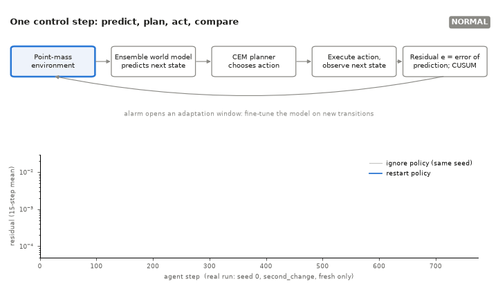

# Interrupted Adaptation in Learned World Models

*An Empirical Study of Restart Policies, Window Length and Experience Replay*

An empirical study of what a model-based agent should do when its dynamics change a second time while it is
still adapting its world model to the first change. The agent learns an ensemble dynamics model, plans with
it, watches its own prediction errors, and fine-tunes the model after a detected change. This repository is
a small, fully reproducible codebase and the measured results; it does not propose a new algorithm.

**[Read the research paper (PDF)](paper/main.pdf)**
· Full report: [`research/report.md`](research/report.md)
· Related work and novelty assessment: [`research/related_work.md`](research/related_work.md)
· Study plan: [`research/plan.md`](research/plan.md)



*The animation replays logged data from one real run (seed 0, `second_change`, fresh-only adaptation, from
`results/s7_redetect`). The curve is the 15-step mean of the logged one-step residual; nothing is simulated.*

## Research motivation

- **World models fail under change.** A model trained on one set of dynamics keeps predicting those
  dynamics after the environment changes. Plans built on it become wrong, and in this task an actuator
  rotation of 60° or more makes every episode fail until the model is updated.
- **A second change during adaptation is a problem.** After an alarm the agent collects new transitions
  and fine-tunes for a bounded window. If the dynamics change again inside that window, the window mixes
  data from two regimes, and a detector that is silenced during adaptation does not notice.
- **Why restart can help.** Re-detecting the new rise and opening a new window that holds only
  post-change data lets the model fit the current regime instead of an average of two.
- **A competing explanation.** Restart also ends the stale window early. A plain short window, with no
  re-detection at all, does the same, so it is tested as a competitor.
- **Replay helps retention but can interfere.** Mixing old transitions into fine-tuning reduces forgetting
  of earlier dynamics, but it also pulls the model towards dynamics that no longer hold.

## Architecture

Only implemented components are listed.

| Component | File | What it does |
|---|---|---|
| Environment | `src/autonomous_agent/env.py` | 2-D point mass, v' = v + dt(g·R(φ)·a − c·v) + noise; walls clip position. Gain g, drag c and actuator rotation φ can change mid-run. |
| Dynamics schedule | `src/autonomous_agent/schedule.py` | Changes the dynamics at fixed episodes (single change, reversion, second change). |
| Ensemble world model | `src/autonomous_agent/world_model.py` | 5 MLPs (2×128, SiLU) predicting state deltas; the exact wall rule is applied to predictions. |
| Planner | `src/autonomous_agent/planner.py` | CEM model-predictive control: horizon 15, 256 candidates, 25 elites, 4 iterations, ensemble rollouts. |
| PD baseline | `src/autonomous_agent/controllers.py` | Tuned PD controller (kp 4, kd 2) and a random controller. |
| Residual monitoring and change detection | `src/autonomous_agent/agent.py` | One-step residual scored before training on it; one-sided CUSUM (drift 0.5, threshold 10) on its calibrated log. |
| Adaptation state machine | `src/autonomous_agent/agent.py` | NORMAL → COLLECTING → ADAPTING → NORMAL. A stricter re-detection CUSUM (drift 1.5, threshold 10) is armed only in ADAPTING, with at most 2 restarts per chain. |
| Restart or ignore | `src/autonomous_agent/agent.py` | `on_alarm_during_adapt`: `restart` opens a new window with post-change data only; `ignore` keeps the old window. |
| Replay | `src/autonomous_agent/agent.py` | Fine-tuning mixes in transitions held before the alarm at ratio ρ (0.25 in the study). |
| Evaluation | `src/autonomous_agent/evaluate.py` | One-step and multi-step error, trivial baselines, uncertainty correlation. |
| Experiment scripts | `scripts/` | One script per experiment (see Reproducibility). |
| Dashboard | `dashboard/` | Static page that replays the logged per-step runs. |

```
NORMAL --alarm--> COLLECTING --50 new rows: fine-tune--> ADAPTING --max_new rows--> NORMAL
                                                            |  re-detection fires (restart policy)
                                                            +--> new window: COLLECTING
```

## Experimental progression

| Step | Question | Outcome |
|---|---|---|
| M1 | Does the learned model beat trivial predictors? | Yes: held-out error 1.40e-3 against 2.83e-3 (constant velocity) and 3.58e-3 (zero delta). |
| 1 | Where does the error come from? | Mostly wall contacts; applying the exact wall rule removed nearly all of it. |
| 2 | Does model-based planning work? | CEM and tuned PD both reached 100% success; the task did not separate them. |
| 3 | Can a gain and drag change be detected? | The residual CUSUM detected it in about 6 steps with no false alarms; ensemble disagreement was not a usable signal. |
| 4 | Does an actuator rotation break control? | Without adaptation, 0% post-change success at 60° and 90°; with residual detection and adaptation, 95.5%. |
| 5 | How fast to adapt, and does replay limit forgetting? | Fine-tuning after 50 new rows with replay 0.25 was selected on tuning seeds; replay roughly halved forgetting. |
| 6 | What happens when the dynamics revert? | The reversion arrived while the window was still open, and its alarm was ignored. |
| 7 | Restart the window on a second rise? | Added the state machine and re-detection, tuned on seeds 100 to 102, evaluated on seeds 0 to 4. |
| 8 | Research study | 10 evaluation seeds, three untuned schedules and the short-window competitor. Reported in the paper. |

## Key findings

From the Step 8 study (10 paired seeds; values from [`research/results/paired.csv`](research/results/paired.csv)).
All comparisons are descriptive: sign counts, means and bootstrap intervals, with no claims of statistical
significance.

- **Restart beat ignore after every rotation second event**: in 40 of 40 fresh-only and 39 of 40 replay
  seed comparisons (four schedules: reversion, second change, late second change, large second change).
- **The short window recovers a substantial portion of restart's gain.** With fresh-only adaptation it
  recovered 114%, 63%, 105% and 54% of restart's return gain over ignore in those four schedules; with
  replay, 69% to 97%. Restart kept a clear advantage mainly when a large change hit a still-open window.
- **Replay is more useful under ignore than under restart.** Replay minus fresh return was up to +10.27
  under ignore, but at most +1.23 under restart.
- **Replay sometimes reduces return.** It lowered return in every seed in the single-change control
  (about −0.55) and after the gain change (about −3).
- **Restart increases forgetting of the intermediate regime.** After the reversion, fresh-only 60° error
  was 1.6e-3 under restart against 1.3e-3 under ignore, because the restarted window trains on
  post-change data only.
- **Gain changes are poorly detected.** Fresh restart missed the gain change within the segment in 3 of 10
  seeds and needed 156 steps on average otherwise; neither restart nor the short window changed return
  measurably.
- **False restarts occurred.** In the control without a second change: 1 in 10 runs fresh-only and 4 in 10
  runs with replay, with no measurable return cost.

## Reproducibility

Tested on macOS (Apple M2, CPU only) with Python 3.13.7, torch 2.14.1, numpy 2.5.4, matplotlib 3.11.2,
PyYAML 6.0.3 and pytest 9.1.1.

```
python3 -m venv .venv
.venv/bin/pip install -e ".[dev]"
.venv/bin/python -m pytest -q          # 32 tests
```

**Experiments.** Run from the project root with the virtual environment active. Seeds are fixed in the
configs. `run_adapt_sweep.py`, `run_reversion.py` and `run_redetect.py` refuse to write into an existing
directory. The other scripts overwrite their `--out` directory, so the commands below write to a new
`runs/` directory and leave the published `results/` intact.

| Step | Command | Published output |
|---|---|---|
| M1 | `python scripts/train_model.py --config configs/default.yaml --out runs/m1` | `results/m1` |
| 1 | `python scripts/compare_wall_handling.py --config configs/default.yaml --out runs/s1_walls` | `results/s1_walls` |
| 2 | `python scripts/run_planning.py --config configs/agent.yaml --out runs/s2_planning` | `results/s2_planning` |
| 3 | `python scripts/run_shift.py --config configs/agent.yaml --out runs/s3_shift` | `results/s3_shift` |
| 4 | `python scripts/run_shift.py --config configs/rotation60.yaml --out runs/s4_rotation60` (and `rotation90`) | `results/s4_rotation60`, `results/s4_rotation90` |
| 5 | `python scripts/run_adapt_sweep.py --phase tune --config configs/adapt60.yaml --out runs/s5_adapt_tune60 --workers 3`, then `--phase eval` with `--selected runs/s5_adapt_tune60/selected.json` and a new `--out` | `results/s5_adapt_tune60`, `results/s5_adapt_eval60`, `results/s5_adapt_eval90` |
| 6 | `python scripts/run_reversion.py --config configs/reversion60.yaml --out runs/s6_reversion --workers 5` | `results/s6_reversion` |
| 7 | `python scripts/run_redetect.py --phase tune --config configs/redetect60.yaml --out runs/s7_redetect_tune --workers 7`, then `--phase eval` with `--out runs/s7_redetect` | `results/s7_redetect_tune`, `results/s7_redetect` |
| 8 | the three `run_redetect.py --config configs/redetect60_ext.yaml` commands in [`research/report.md`](research/report.md), Section 10, with their `--out` changed to a new path | `results/s8_short_s0_4`, `results/s8_seeds5_9`, `results/s8_newscen` |

Runs are deterministic on one machine for a given seed. A seed-0 rerun of the Step 8 configuration
reproduced the episode returns in `results/s7_redetect` exactly.

**Plots.** Each experiment script writes its own plots (PNG) into its `--out` directory, so rerunning a
command regenerates them. `run_reversion.py --replot` redraws the Step 6 figure from an existing output
directory without rerunning. The summary tables in `research/results/` and the figures in
`research/figures/` and `paper/figures/` are published as produced; the script that assembled them from the
run directories is not part of this repository.

**Dashboard.**

```
python -m http.server 8000      # from the project root
open "http://localhost:8000/dashboard/?run=s7_redetect/second_change"
```

Model checkpoints (`*.pt`) and collected training data (`*.npz`) are not published; every run regenerates
them.

## Limitations

- **A small simulated environment.** A 2-D point mass with near-linear dynamics and low noise; the changes
  are actuator rotations and a gain change, which an MLP relearns easily.
- **10 evaluation seeds**, with tuning on 3 separate seeds. Differences are reported per seed.
- **Descriptive analysis only.** Sign counts and bootstrap intervals, no significance claims.
- **Rotation-tuned detectors.** The re-detection drift and threshold were selected on rotation changes,
  which is one reason the gain change was detected poorly.
- **No per-context model library baseline.** Methods that store and reuse one model per regime were not
  compared.
- **The combined policy is untested.** Restart and a short window were evaluated separately, not together.

## Repository structure

```
README.md, LICENSE, pyproject.toml
assets/research_workflow.gif   workflow animation (real logged data)
paper/main.pdf                 the research paper
paper/figures/                 figures used in the paper
research/                      report.md, related_work.md, plan.md, results/ (tables), figures/
src/autonomous_agent/          environment, world model, planner, controllers, agent, evaluation
scripts/                       one script per experiment
configs/                       YAML configuration for every experiment
results/                       per-run metrics, summaries, logs and plots (Steps M1 to 8)
dashboard/                     static replay of logged runs
tests/                         pytest suite
```

## Provenance

The methods were implemented from their published descriptions: deep ensembles (Lakshminarayanan et al.,
2017), CEM-MPC with trajectory sampling (Chua et al., 2018), CUSUM (Page, 1954) and experience replay
against forgetting. No third-party code was copied.

## License

The code and documents in this repository are released under the [MIT License](LICENSE),
Copyright (c) 2026 Aditya Raj. Third-party dependencies (numpy, torch, matplotlib, PyYAML, pytest) are
installed separately and remain under their own licenses.
