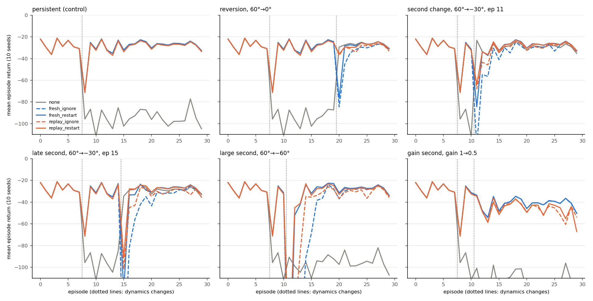
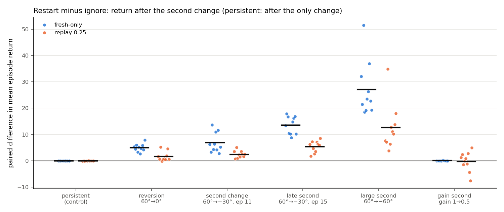
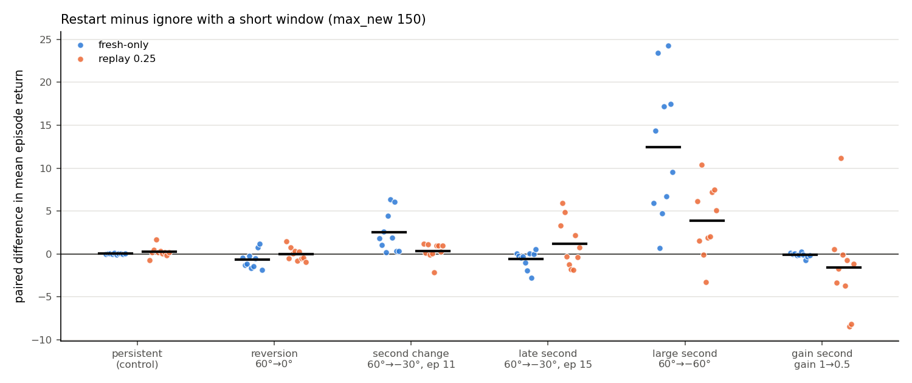
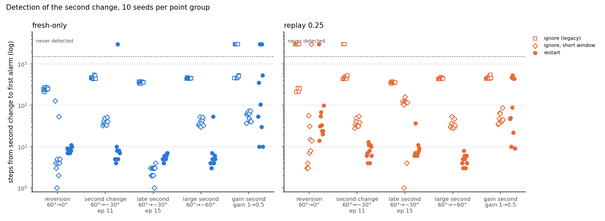
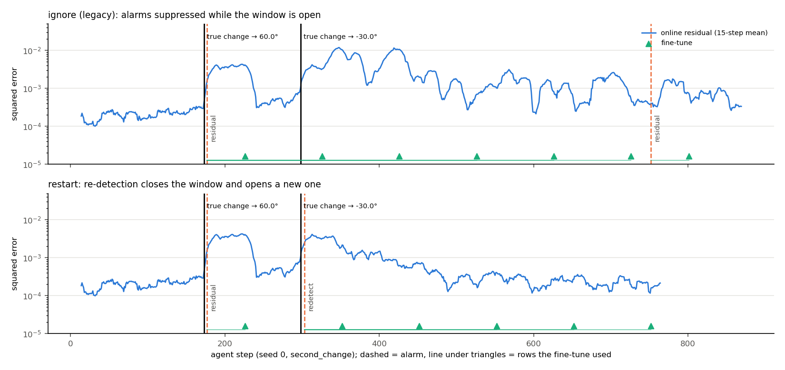
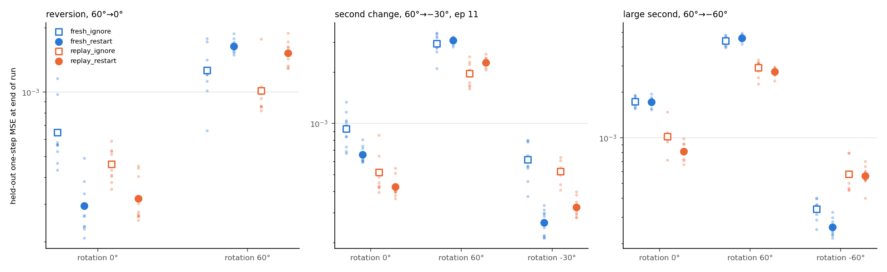
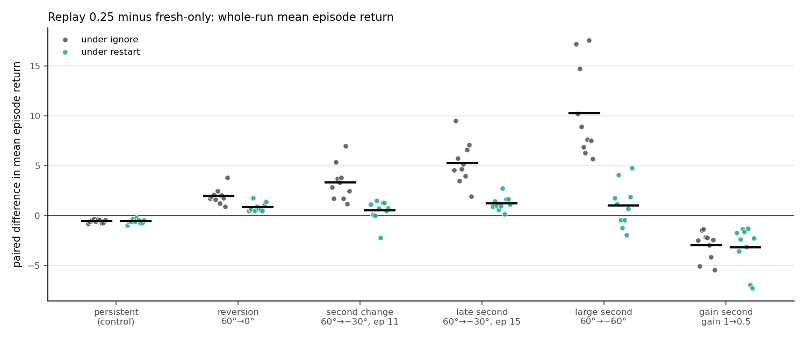

# Interrupted Adaptation: Second Dynamics Changes During World Model Fine Tuning

## Abstract

A model based agent that fine tunes its world model inside a detector triggered adaptation window
usually ignores further alarms until the window closes. We measure what this costs when the dynamics change
again inside the window, using a point mass controlled by cross entropy planning over a neural network
ensemble, six change schedules (three never used for tuning) and ten paired evaluation seeds. Restarting the
window on a separate, stricter re-detection improved return after a second rotation change in all 40 fresh
only seed comparisons (by 4.9 to 27.2 return units on average) and in 39 of 40 with replay, without a
measurable cost when only one change occurred. A competing explanation largely holds: the legacy policy with
a shorter window recovered at least half of that improvement in every rotation schedule, and all of it in
two of four. Restart kept a clear advantage only when a large change hit a window that was still open.
Replay of old data helped strongly under the legacy policy but little under restart, and it reduced return
in every seed after a single permanent change and after a gain change. The restart mechanism is not new; it is the
single model case of established context detection methods. The contribution is a controlled measurement
of how interruption policy, window length and replay interact in this one small system.

## 1. Introduction

A model based agent that plans with a learned dynamics model has to notice when the real dynamics stop
matching the model, and then correct the model. A common and simple way to do this is to monitor the one
step prediction error, raise an alarm when it rises persistently, and then fine tune the model on
transitions collected after the alarm. Because a fine tune needs data, the agent opens an *adaptation
window*. It collects fresh transitions, fine tunes after a minimum number of them, fine tunes again as more
arrive, and closes the window after a fixed budget. While the window is open, further alarms are usually
ignored. The model is expected to be wrong at this point, and reacting to every alarm would make the agent
retrain without end.

This design has a blind spot. If the dynamics change again while the window is open, the agent keeps fitting
a single model to a mixture of transitions from two different regimes, and it cannot react until the window
closes. Recurring dynamics make this more likely, not less. A temporary fault that is repaired, a payload
that is picked up and put down, or an actuator that is recalibrated can return the system to its earlier
behaviour within the lifetime of one adaptation window.

This report studies that blind spot in a deliberately small system: a two dimensional point mass whose
actuator direction is rotated without warning, controlled by cross entropy model predictive control over a
five member neural network ensemble. The project behind it was built in stages, and its earlier stages are
reused here as evidence: the model, the planner, the detector, replay, and a reversion experiment. The
research question is:

> How should a single model, window based adaptation scheme manage a new dynamics change that arrives
> before adaptation to the previous change has finished, and how does this interact with experience replay
> when earlier dynamics can return?

The mechanism we evaluate is not new. Restarting a learning window when a change is detected, and refusing
to trust a detector until enough recent data exist, are standard moves in stream learning (ADWIN, DDM). They
are also embedded in model based context detection methods such as MBCD, which go further and keep one
dynamics model per context. Section 2 sets out this overlap. The contribution claimed here is therefore
empirical and narrow:

1. A controlled, seed paired measurement of the cost of suppressing alarms during an adaptation window.
   It covers six change schedules, three of them never used for tuning, with ten evaluation seeds each.
2. A test of the most obvious competing explanation: that a restart helps only because the stale window
   ends sooner.
3. A characterisation, in the same system, of when a fixed replay ratio helps whole run control, and what
   restarts cost in false alarms, compute and forgetting.

In short (Section 6): restart improved control after a second rotation change in every seed, but most of
that gain could also be had by simply shortening the window; restart helped clearly more only when a large
change arrived while the window was still open. Replay looked very useful under the legacy policy, but
mainly because it compensated for the stale window, and it hurt after a single permanent change.

## 2. Related Work

A table with the access status of every source is in `research/related_work.md`.

**Model based control under changing dynamics.**
- PETS (Chua et al., 2018) introduced probabilistic ensembles with trajectory sampling and cross entropy
  planning. Our planner follows its sampling scheme with deterministic ensemble members.
- Nagabandi, Clavera et al. (2019) meta learn a dynamics prior and adapt it continuously from a recent
  window of transitions, so there is no discrete adaptation window to interrupt.
- Context conditioned models (Lee et al., 2020) infer a latent context from recent transitions and need no
  explicit change detection at all.

**Detect then adapt.**
- Several deep reinforcement learning methods detect a change point and then adapt.
- Padakandla et al. (2020) couple change point detection on environment statistics with a learning
  algorithm.
- Liu et al. (2024) monitor the joint distribution of states and actions.
- LLCD (Liu et al., 2025) runs Bayesian online change point detection (Adams and MacKay, 2007) on the
  latent states of a PlaNet style model. When a change is declared, it adds a temporary regulariser to
  model training and removes it after several updates. That temporary phase plays the role of our
  adaptation window. We read the method in the first author's open thesis, not in the journal version.

**Recurring contexts and model libraries.** The closest prior work keeps several models.
- RL-CD (da Silva et al., 2006) tracks the prediction quality of each model and creates a new one when none
  fits. We know this method only through the description in Alegre et al. (2021).
- MOLe (Nagabandi, Finn and Levine, 2019) assigns each time step to a mixture component with a Chinese
  restaurant process prior and recalls old components when earlier tasks return.
- Xu et al. (2020) do the same with a mixture of Gaussian process experts.
- MBCD (Alegre, Bazzan and da Silva, 2021) runs a multivariate CUSUM (Page, 1954) of log likelihood ratios
  against every known context model and against a "new context" alternative. It reuses earlier models when
  their statistic wins.

Two features of MBCD matter here. First, it computes detection statistics only after a warm-up period in
each new context, and the authors argue that some such period is a necessary assumption. Second, after a
switch, new transitions go to the new context's dataset, so they never mix with the old one. Our restart
policy is essentially the single model special case of this design. What our agent lacks, and MBCD has, is a
library of models that can be reused when a context recurs.

**Stale data and forgetting.**
- Rahimi-Kalahroudi et al. (2023) show that a first in first out replay buffer keeps stale transitions that
  corrupt a deep world model after a local change. They propose deleting only the old samples in the
  neighbourhood of each new one.
- Experience replay is the standard defence against catastrophic forgetting in continual reinforcement
  learning (Rolnick et al., 2019), alongside regularisation methods such as EWC (Kirkpatrick et al., 2017).
- DRAGO (Fu et al., 2025) retains world model knowledge across tasks without stored data, through
  generative rehearsal and exploration. It assumes known task switches and shared dynamics, so its setting
  is complementary to ours.
- Khetarpal et al. (2022) survey continual reinforcement learning more broadly.

**Stream learning.**
- ADWIN (Bifet and Gavaldà, 2007) grows its window while data are stationary and shrinks it when a change
  is detected, discarding stale data.
- DDM (Gama et al., 2004) monitors the online error rate with warning and drift levels. Common
  implementations do not signal a change before a minimum number of samples has been seen.

**What remains.** None of the sources we read reports a controlled measurement of the specific failure
studied here. In a single model, window based pipeline, alarm suppression during an open window costs
control when a second change arrives. Nor do they separate that cost from the effect of window length, or
measure how it interacts with replay. This is an evaluation gap about a common engineering pattern, not an
unsolved algorithmic problem.

## 3. Problem Formulation

**System.** The state is $s_t = (p_t, v_t) \in \mathbb{R}^4$, with position $p_t$ and velocity $v_t$ in the
plane. The action is $a_t \in [-1, 1]^2$. The dynamics parameters $\theta = (g, c, \varphi)$ are the
actuator gain, the linear drag and the actuator rotation. With $\Delta t = 0.1$:

$$v_{t+1} = v_t + \Delta t\,\big(g\,R(\varphi)\,a_t - c\,v_t\big) + \sigma\,\epsilon_t, \qquad p_{t+1} = p_t + \Delta t\, v_{t+1},$$

where $R(\varphi)$ is the planar rotation matrix, $\epsilon_t \sim \mathcal{N}(0, I)$ and $\sigma = 0.02$.
The arena is the square $[-2, 2]^2$. A position component that leaves it is clipped to the wall, and that
velocity component is set to zero. The defaults are $g = 1$, $c = 0.5$ and $\varphi = 0$.

**Task.** Each episode samples a start position and a goal in $[-1.6, 1.6]^2$, at least 1 apart, with zero
initial velocity. The reward is

$$r_t = -\big(\lVert p_{t+1} - p^{\ast}\rVert + 0.01\,\lVert a_t\rVert^2\big).$$

An episode ends with success when $\lVert p_{t+1} - p^{\ast}\rVert < 0.15$, or after 100 steps. The
return of an episode is the sum of its rewards. A failed episode therefore scores roughly between −80
and −200.

**Non-stationarity.** A run is a sequence of 30 episodes. The dynamics parameters are piecewise constant
over episodes and follow a schedule $\theta^{(0)}, \theta^{(1)}, \ldots$ that switches at the first step of
given episodes. The agent is never told the schedule, the switch times or the parameter values. Only
clearly labelled oracle references receive the switch episodes.

**Quantities of interest.**
- The return in each segment of the schedule and over the whole run.
- Several time points for each change, kept distinct throughout:
  - the true change step;
  - the first alarm after it;
  - the start of the adaptation window that serves it;
  - the first fine tune that uses only post change data (the "clean" fine tune);
  - recovery of control.
- Prediction error on held out data from every regime.
- The compute spent on fine tuning.

## 4. Method

### 4.1 Learned model and planner

The world model is an ensemble of $E = 5$ multilayer perceptrons with two hidden layers of 128 SiLU units.
Each member predicts the normalised state difference $s_{t+1} - s_t$ from $(s_t, a_t)$. Members differ by
initialisation and by bootstrap resampling of the training set. Two pieces of known structure are used:
- predictions are passed through the simulator's wall rule;
- the networks are trained only on transitions without a wall contact.

Appendix A shows why: wall contacts carried most of the error of an unstructured model.

Pretraining uses 30 episodes of temporally correlated random actions (60 epochs, Adam, learning rate
$10^{-3}$, weight decay $10^{-5}$, batch 256).

The planner is cross entropy model predictive control:
- horizon 15, 256 candidate action sequences, 25 elites, 4 iterations;
- initial standard deviation 0.6, with a warm start from the previous plan.

Every member rolls out every candidate. The cost of a sequence is the member mean of the summed per step
cost, and only the first action is executed.

### 4.2 Online residual and change detection

At each step the agent scores the transition it just observed with the model as it was before seeing it:

$$e_t = \tfrac{1}{4}\,\big\lVert \bar f(s_t, a_t) - s_{t+1}\big\rVert^2, \qquad \bar f = \tfrac{1}{E}\textstyle\sum_e f_e .$$

The detector is a one sided CUSUM on the standardised log residual:

$$z_t = \frac{\log(e_t + 10^{-10}) - \mu}{\varsigma}, \qquad S_t = \max(0,\, S_{t-1} + z_t - k), \qquad \text{alarm if } S_t > h .$$

The reference values $\mu$ and $\varsigma$ come from five calibration episodes run with the pretrained model.
Those episodes use reset seeds that are never used for training (109 steps for seed 0). The main detector
uses $k = 0.5$ and $h = 10$. A second statistic built on ensemble disagreement was also evaluated in
earlier stages and rejected (Appendix A).

### 4.3 Adaptation windows and replay

An alarm opens a window. The window collects every subsequent transition. A fine tune runs when the
window holds 50, 150, 250, … transitions, and the window closes after the fine tune at which it holds at
least `max_new` transitions. With `max_new` = 500 this means six fine tunes, the last on 550
transitions.

Each fine tune:
- warm starts every member;
- runs 40 epochs of Adam at learning rate $10^{-3}$ on a bootstrap resample;
- keeps the input and output normalisers of pretraining;
- excludes wall contacts.

After each fine tune the detector statistics are reset.

With replay ratio $\rho$, a fine tune on $n$ window transitions adds $\mathrm{round}(n\rho/(1-\rho))$ old
transitions. These are drawn without replacement from the pretraining data together with all online
transitions that precede the current window. With $\rho = 0.25$ the fine tuning set is one quarter old
data. With $\rho = 0$ it uses only window data ("fresh only").

### 4.4 Interruption policies

```
state NORMAL:      main CUSUM runs; alarm -> open window, state COLLECTING
state COLLECTING:  store transitions; main alarms ignored; re-detection disarmed
                   at 50 window rows: fine tune -> state ADAPTING
state ADAPTING:    fine tune every 100 further rows; main alarms ignored
                   policy ignore:  nothing else
                   policy restart: re-detection CUSUM (k_r, h_r) runs, reset after each fine tune;
                                   if S_r > h_r and restarts in this chain < 2:
                                       close window (its rows join the replay pool),
                                       open a new window at this step -> COLLECTING
                   window reaches max_new rows (after its fine tune) -> NORMAL
```

We compare three policies:
- **ignore** (legacy): alarms during an open window are discarded until it closes.
- **restart**: a separate re-detection CUSUM, on the same standardised residual scale, runs only in
  ADAPTING, that is after the window's first fine tune.
  - Its larger drift, $k_r = 1.5$ with $h_r = 10$, is needed because a partly adapted model keeps the
    residual moderately high without any new change. In one logged run, the main detector would have fired
    on 414 of 816 steps.
  - At most two restarts are allowed per chain of windows. The counter resets when a main detector alarm
    opens a new chain from NORMAL.
  - The restart is a hard cut. Transitions between the true change and the re-detection stay in the closed
    window and are treated as old data.
- **ignore\_short**: the ignore policy with `max_new` = 150, so each window has two fine tunes. This is a
  competing explanation, not a proposed method. If restart helps only because it ends the stale window
  sooner, a shorter window should help as much. The value 150 was fixed before any run, as the shortest
  window with more than one update.

The re-detection parameters were selected on tuning seeds (Section 5) by a rule fixed before the sweep. No
policy uses the true schedule.

## 5. Experimental Setup

**Seeds.** Every agent seed $a$ fixes its own pretraining data, model initialisation, calibration
episodes, held out sets and the reset seeds of its 30 episodes. The seed ranges are disjoint by
construction:
- pretraining: $1000(a+1)+i$;
- calibration: $7000(a+1)+i$;
- episodes: $4000(a+1)+i$;
- held out: $9000(a+1)+i$.

Tuning used agent seeds 100, 101 and 102. Evaluation used agent seeds 0 to 9. Within a seed, all
conditions start from the identical pretrained model and see identical episode resets, so the comparisons
are paired.

**Schedules.** Rotation is 0° for episodes 0 to 7 in every schedule; a change at episode 8 is the first
change.

| Schedule | First change (episode 8) | Second change | Used for tuning |
|---|---|---|---|
| persistent | 0° → 60° | none (control) | yes |
| reversion | 0° → 60° | 60° → 0° at episode 20 | no |
| second_change | 0° → 60° | 60° → −30° at episode 11 | yes |
| late_second | 0° → 60° | 60° → −30° at episode 15 | no |
| large_second | 0° → 60° | 60° → −60° at episode 11 | no |
| gain_second | 0° → 60° | gain 1 → 0.5 at episode 11, rotation stays 60° | no |

**Conditions.** We cross two replay settings with three policies:
- replay settings: fresh only ($\rho = 0$) and replay ($\rho = 0.25$);
- policies: ignore, restart and ignore\_short;
- all with `min_new` = 50.

References: no adaptation, plus two oracles that are told the change episodes and restart a window there.
Oracles are upper references, not methods.

**Re-detection tuning.** The tuning grid was drift {1.0, 1.5, 2.0} × threshold {10, 20}. It was run on
tuning seeds in the persistent and second_change schedules. The selection rule, fixed in advance, was:
1. keep the settings within one of the fewest restarts in the persistent control (each such restart is
   false by construction);
2. among those, choose the highest second_change return;
3. break ties towards the more conservative setting.

The rule selected drift 1.5 and threshold 10, with 1 false restart in 6 control runs.

**Metrics.** All metrics are computed per run (`scripts/run_redetect.py`, `run_metrics`) and aggregated
across seeds.
- *Segment return:* the mean episode return over the episodes of a segment.
- *Detection delay:* steps from the true change to the first alarm of any kind before the next change,
  whether a main detector alarm, a re-detection or an oracle trigger. Under ignore, this alarm can only
  come from the main detector after the old window has closed.
- *Clean fine tune delay:* steps from the change to the first fine tune whose window opened at or after
  the change.
- *Recovery:* the index of the first episode after the change that begins three consecutive successes.
- *False restarts:* restarts in the persistent schedule.
- *Held out error:* the one step mean squared error of the model on 10 random policy episodes per regime.
  These are collected under that regime from reset seeds no agent trains on, and measured at the end of
  each segment. They only ever enter the error computation, never training.
- *Cost:* the number of fine tunes and their wall clock seconds. Seconds depend on machine load because
  runs execute in parallel.

**Statistics.** The unit of analysis is the agent seed; time steps within a run are never treated as
samples. For each comparison we report:
- the per seed paired differences;
- their mean and standard deviation;
- the number of positive seeds;
- an exact two sided sign test;
- a 95% percentile bootstrap interval over seeds.

With ten seeds and many comparisons, these numbers are descriptive and are not corrected for multiplicity.

**Data sources.**

| Directory | Seeds | Schedules | Conditions |
|---|---|---|---|
| `results/s7_redetect` | 0–4 | persistent, reversion, second_change | all but ignore\_short |
| `results/s8_short_s0_4` | 0–4 | same | ignore\_short |
| `results/s8_seeds5_9` | 5–9 | same | all |
| `results/s8_newscen` | 0–9 | the three untuned schedules | all except oracles |

Every table and figure in this report was computed from these saved results (`research/results` holds the
merged tables). The analysis script itself is not published in this repository.

## 6. Results

All numbers are means over evaluation seeds 0 to 9 unless stated. A paired difference "A − B" is computed
per seed and then averaged; "k/10" is the number of seeds in which it is positive; the interval is the 95%
bootstrap interval of the mean. The full set of comparisons, with per seed values, is in
`research/results/paired.csv`, and every per condition mean is in `research/results/summary.csv`. The
outcome for RQ1 and C1 is the mean episode return of the segment after the second change (after the only
change, in the persistent control). Returns are negative; higher is better.



*Figure 1. Mean return per episode for no adaptation (grey), ignore (dashed) and restart (solid), fresh
only (blue) and replay 0.25 (orange). Dotted vertical lines mark the changes. The y axis is clipped at −110,
which cuts off the first failed episode after some changes; the cut values are in `summary.csv`.*

### 6.1 RQ1: restart against ignore

| Schedule | Fresh only: restart − ignore | Replay 0.25: restart − ignore |
|---|---|---|
| persistent (control) | −0.01 (0/10; 9 ties), [−0.02, 0.00] | −0.03 (1/10; 7 ties), [−0.10, 0.02] |
| reversion | **+4.93** (10/10), [4.07, 5.85] | **+1.60** (9/10), [0.62, 2.77] |
| second_change | **+6.83** (10/10), [4.73, 9.19] | **+2.41** (10/10), [1.65, 3.22] |
| late_second | **+13.53** (10/10), [11.56, 15.46] | **+5.39** (10/10), [4.04, 6.64] |
| large_second | **+27.16** (10/10), [21.80, 33.84] | **+12.57** (10/10), [8.16, 18.32] |
| gain_second | +0.03 (3/10), [−0.01, 0.07] | −0.27 (5/10), [−2.49, 1.76] |

*Table 1. Return after the second change, restart minus ignore. Bold: all or all but one seed agree in
sign and the interval excludes zero.*

In every schedule where the second change is a rotation, restart improved the return after it, in all ten
seeds for fresh only and in 39 of 40 seed comparisons with replay. The improvement grows with the size of
the second change (−30° at episode 11: +6.8; −60° at episode 11: +27.2, fresh only). It is larger without
replay than with replay in all four rotation schedules. In the persistent control restart changed almost
nothing, as it should. In gain_second it changed nothing measurable (Section 6.6).



*Figure 2. Per seed paired differences of Table 1; bars are means.*

### 6.2 The competing explanation C1: does a shorter window do as well?

| Schedule | Fresh: short − ignore | Fresh: restart − short | Replay: short − ignore | Replay: restart − short |
|---|---|---|---|---|
| persistent | −0.02 (4/10) | +0.02 (6/10) | −0.27 (2/10) | +0.24 (8/10), [−0.10, 0.62] |
| reversion | +5.61 (10/10) | **−0.68 (2/10)**, [−1.24, −0.07] | +1.64 (9/10) | −0.04 (5/10), [−0.45, 0.43] |
| second_change | +4.33 (10/10) | **+2.51 (10/10)**, [1.23, 3.92] | +2.06 (10/10) | +0.34 (8/10), [−0.33, 0.85] |
| late_second | +14.16 (10/10) | −0.62 (3/10), [−1.25, −0.09] | +4.25 (9/10) | +1.14 (5/10), [−0.42, 2.81] |
| large_second | +14.72 (10/10) | **+12.44 (10/10)**, [7.82, 17.26] | +8.73 (10/10) | **+3.84 (8/10)**, [1.35, 6.19] |
| gain_second | +0.15 (7/10) | −0.12 (3/10) | +1.30 (9/10) | −1.58 (2/10), [−4.51, 1.88] |

*Table 2. Return after the second change. "short" is ignore with `max_new` 150.*

The short window recovered most of what restart gains over ignore. Measured against the ignore baseline,
it achieved more than restart in reversion and late_second with fresh only, 63% of restart's gain in
second_change, and 54% in large_second. Restart was clearly better than the short window in two places:
second_change and large_second with fresh only, and large_second with replay. It was slightly worse in
reversion with fresh only (8 of 10 seeds; a mean of 0.68 return units, under one percent of a failed
episode). Everywhere else the two were indistinguishable at ten seeds.



*Figure 3. Per seed paired differences, restart minus ignore\_short.*

### 6.3 Detection and the clean fine tune

| Schedule | ignore: delay / clean FT | short: delay / clean FT | restart: delay / clean FT |
|---|---|---|---|
| reversion, fresh | 245.8 / 291.9 (1 never) | 20.9 / 69.9 | 8.4 / 57.4 |
| reversion, replay | 235.8 (6 never) / 259.0 (9 never) | 15.7 (1 never) / 64.7 | 40.8 (1 never) / 89.8 |
| second_change, fresh | 473.2 / 506.8 (2 never) | 39.2 / 88.2 | 6.7 (1 never) / 55.7 |
| second_change, replay | 473.1 (2 never) / 494.5 (6 never) | 37.4 / 86.4 | 8.0 / 57.0 |
| late_second, fresh | 358.6 / 407.6 | 2.5 / 51.5 | 5.6 / 54.6 |
| late_second, replay | 355.5 / 404.5 | 98.6 / 147.6 | 10.5 / 59.5 |
| large_second, fresh | 449.1 / 498.1 | 39.4 / 88.4 | 9.6 / 58.6 |
| large_second, replay | 446.7 / 495.7 | 35.4 / 84.4 | 5.0 / 54.0 |
| gain_second, fresh | 483.6 (5 never) / 532.6 | 56.5 / 105.5 | 155.9 (3 never) / 204.9 |
| gain_second, replay | 467.9 / 516.9 | 50.1 / 99.1 | 209.9 / 258.9 |

*Table 3. Mean steps from the second change to the first alarm of any kind ("delay") and to the first fine
tune on a window that opened after the change ("clean FT"). Means are over the seeds where the event
happened before the next change or the end of the run; "k never" counts the others. The oracles have delay
0 and clean FT 49 by construction.*

Under ignore, the first alarm after a second change came 236 to 484 steps late, which is several episodes:
the main detector cannot fire until the first window closes. Under restart the re-detection fired 5 to 11 steps after a rotation change on average. The exception is the
reversion with replay (40.8 steps): replay had kept the model closer to 0°, so the residual rose less. One
run per arm was counted as never detected; Section 7.4 explains both. The short
window fell in between: about 35 to 40 steps when the change hit an open window, and 2.5 steps in
late_second with fresh only, where the short window had already closed and the main detector was armed.

With replay under ignore, the reversion to 0° went undetected in 6 of 10 seeds. Replay keeps the model
accurate on 0°, so the residual barely rose (held out error on 0° just before the reversion: 9.3e-4 with replay
against 1.6e-3 fresh only).



*Figure 4. Detection delay of the second change per seed, on a log scale. Points above the dotted line
were never detected within the segment.*



*Figure 5. Seed 0, second\_change, fresh only. Top: under ignore the residual stays between about 1e-3 and
1e-2 for hundreds of steps after the −30° change at step 298, while the window keeps fine tuning on mixed
data; the next alarm comes at step 752. Bottom: restart re-detects at step 303 and opens a new window.*

### 6.4 RQ2: what restart costs

**False restarts.** In the persistent control every restart is false. Fresh only had 1 false restart in
10 runs (seed 5); replay had 4, in seeds 0 (two), 2 and 5. Return in the control was unaffected
(Table 1). The tuning sweep (Appendix C) predicted this rate: 1 false restart in 6 tuning runs.

**Follow up restarts.** After a large second change the first fine tune of the new window, on 50 rows,
often left the residual high enough to trigger a second restart. This happened in 9 of 10 seeds in
large_second (both arms) and in late_second with fresh only, and it used up the restart budget of two.
Restart spent about as many or fewer fine tunes than ignore, because each restart replaces the remaining
fine tunes of the old window:

| Schedule | ignore | short | restart | oracle |
|---|---|---|---|---|
| persistent | 5.4 / 1.86 s | 2.4 / 0.45 s | 5.4 / 1.83 s | 5.2 / 1.74 s |
| reversion | 6.9 / 2.33 s | 4.5 / 0.87 s | 5.9 / 1.21 s | 5.8 / 1.26 s |
| second_change | 6.9 / 2.27 s | 5.1 / 0.91 s | 5.9 / 1.57 s | 5.9 / 1.51 s |
| late_second | 7.8 / 2.54 s | 4.9 / 0.90 s | 6.2 / 1.30 s | |
| large_second | 9.1 / 2.39 s | 6.4 / 1.10 s | 6.4 / 1.59 s | |
| gain_second | 6.7 / 2.29 s | 4.8 / 0.87 s | 6.8 / 2.18 s | |

*Table 4. Fine tunes per run / total fine tune seconds per run, fresh only (replay is similar and is in
`summary.csv`). Seconds were measured with seven runs in parallel and are indicative only.*

**Forgetting.** The price of restart is paid in the intermediate regime. After a reversion, restart and
the short window both ended with a worse model of 60° than ignore did:

| Schedule, end of run | Regime | fresh ignore | fresh short | fresh restart | replay ignore | replay short | replay restart |
|---|---|---|---|---|---|---|---|
| reversion | 0° | 6.5e-4 | 3.3e-4 | 2.9e-4 | 4.6e-4 | 3.0e-4 | 3.2e-4 |
| reversion | 60° | 1.3e-3 | 1.6e-3 | 1.6e-3 | 1.0e-3 | 1.5e-3 | 1.5e-3 |
| second_change | −30° | 6.1e-4 | 3.6e-4 | 2.6e-4 | 5.2e-4 | 3.4e-4 | 3.2e-4 |
| second_change | 60° | 3.0e-3 | 2.9e-3 | 3.1e-3 | 2.0e-3 | 2.4e-3 | 2.3e-3 |
| large_second | −60° | 3.4e-4 | 3.2e-4 | 2.6e-4 | 5.8e-4 | 4.9e-4 | 5.6e-4 |
| large_second | 60° | 4.4e-3 | 4.4e-3 | 4.5e-3 | 2.9e-3 | 3.2e-3 | 2.7e-3 |

*Table 5. Held out one step error at the end of the run. For reference, the pretrained model has 2.3e-4
on 0° and 1.7e-3 on 60°.*

Under ignore, the stale window keeps some 60° rows in the fine tuning set until it closes, and this
retained the 60° regime slightly better; this is the same mixing that hurts control after the change.
Replay reduced forgetting of 60° in every schedule and every policy, and cost accuracy on the newest regime
(−60°: 5.6e-4 with replay restart against 2.6e-4 fresh restart; −30°: 3.2e-4 against 2.6e-4).



*Figure 6. End of run held out error per regime; small points are seeds.*

### 6.5 RQ3: when does replay 0.25 help whole run return?

| Schedule | under ignore | under restart | under short |
|---|---|---|---|
| persistent | −0.55 (0/10), [−0.65, −0.46] | −0.57 (0/10), [−0.70, −0.45] | −0.73 (0/10) |
| reversion | **+1.96 (10/10)**, [1.54, 2.48] | **+0.84 (10/10)**, [0.62, 1.12] | +0.60 (8/10), [0.26, 0.94] |
| second_change | +3.31 (10/10), [2.32, 4.41] | +0.51 (9/10), [−0.22, 1.04] | +1.87 (10/10) |
| late_second | +5.28 (10/10), [4.08, 6.58] | +1.23 (10/10), [0.83, 1.68] | +0.33 (6/10), [−0.52, 1.18] |
| large_second | +10.27 (10/10), [7.80, 13.11] | +1.03 (6/10), [−0.23, 2.35] | +6.48 (10/10) |
| gain_second | −2.97 (0/10), [−3.87, −2.18] | −3.16 (0/10), [−4.57, −1.99] | −2.24 (0/10) |

*Table 6. Whole run mean return, replay 0.25 minus fresh only, per interruption policy.*

Replay cost a small, consistent amount after a single permanent change (persistent: about −0.55 in every
seed under every policy) and a larger amount in gain_second (about −3). Under ignore it helped in
every two change rotation schedule, by up to 10 return units. Under restart most of that benefit
disappeared: what remained was +0.84 in reversion (all seeds) and +1.23 in late_second (all seeds), with
second_change and large_second not distinguishable from zero.



*Figure 7. Per seed paired differences of Table 6 under ignore and restart.*

### 6.6 The gain change

Halving the actuator gain at 60° rotation was barely visible to the agents. The first episode after it
returned −33.6 in every adaptive condition, the same as the episodes before it, and success after the change
was 99 to 100%. The residual rose only slightly: fresh restart missed the
change within the segment in 3 of 10 seeds and took 156 steps on average otherwise. Neither restart nor the
short window changed return measurably. The no adaptation reference failed here for a different reason: it
never adapted to the first change.

### 6.7 RQ4: one replay ratio for permanent and reversible changes

The earlier Step 5 sweep (seeds 0 to 4, a single permanent change, fresh only) and the reversion schedule
above answer this without new runs.

| Change | Ratio 0 | Ratio 0.25 | Ratio 0.5 |
|---|---|---|---|
| permanent 60°: post change return | −27.25 | −28.01 | −28.88 |
| permanent 90°: post change return | −29.80 | −32.62 | −37.94 |
| permanent 90°: first post change episode success | 5/5 | 3/5 | 1/5 |
| reversion, ignore: return after reverting (10 seeds) | −37.02 | −30.17 | |
| reversion, restart: return after reverting (10 seeds) | −32.09 | −28.57 | |

*Table 7. Ratio 0 is best for a permanent change, and the cost of replay grows with the size of the change;
ratio 0.25 is better when the earlier regime returns. Step 5 data: `results/s5_adapt_eval60`,
`results/s5_adapt_eval90`.*

No single ratio was best in both kinds of schedule, so H4 is supported in this system.

### 6.8 Comparison with the oracles

Restart came close to the oracle that is told the change episodes. Return after the second change in
second_change: restart −30.84 against oracle −31.08 (fresh), −29.93 against −29.47 (replay). After a
reversion: restart −32.09 against oracle −31.30 (fresh), −28.57 against −28.27 (replay); the short window
reached −31.41 and −28.53. The oracle is not an upper bound in practice: it starts its window at the first
step of the change episode, and fine tunes on the same schedule, so a learned detector that fires a few
steps later can match it.

## 7. Analysis

Observations, interpretations and untested hypotheses are kept apart below.

### 7.1 Why ignore fails

*Observation.* Under ignore, after a second change inside an open window, the agent keeps fine tuning on a
window that mixes both regimes, and the next alarm arrives 236 to 484 steps later (Table 3). In the seed
shown in Figure 5 the online residual stays several times higher than under restart during that time. The loss grows with
the size of the change (Table 1).

*Interpretation.* Two things go wrong, and the short window baseline separates them. One is that the
agent is blind to the change for as long as the window stays open. The other is that every fine tune in
the stale window fits a single model to transitions from two different regimes. Shortening the window
addresses the first by letting the main detector fire sooner, and partly addresses the second because
fewer fine tunes see mixed data. Restart addresses both, at the cost of a second detector with its own
false alarms.

### 7.2 How much of restart's gain is window length (C1)

*Observation.* Ignore with `max_new` 150 recovered 54 to over 100% of restart's improvement over the
legacy policy (Table 2). It matched or beat restart when the change arrived after the short window had
closed (late_second, fresh only) and after a reversion to the pretraining regime. Restart kept a clear
advantage after a change that arrived while even the short window was open (second_change, fresh only:
+2.51 in all seeds) and after the largest change (large_second: +12.44 fresh, +3.84 replay).

*Interpretation.* C1 is partly true. A large part of the cost of the legacy policy is the length of the
window, not the suppression of alarms as such. The remaining advantage of restart appears when a second
change hits a window that is still open and the change is large. In large_second the short window detects
the change about 39 steps late and then closes after two fine tunes; the agent then relies on the main
detector to open another window, and recovery took 1.7 episodes against 0.6 under restart (fresh only,
`summary.csv`).

*Interpretation of a negative result.* The short window is also not free. In the persistent control it
did as well as the long window with fresh only, but with replay it was slightly worse (−0.27, 2/10 seeds,
interval including zero). We did not find a clear mechanism for the small reversion deficit of restart
against the short window (−0.68, 8 of 10 seeds). The model error on 0° just before the reversion was the
same under both policies (1.6e-3 to 1.7e-3), and restart detected the reversion earlier (8.4 against 20.9
steps). We report this as unexplained.

*Hypothesis (not tested).* Restart and a short window address different parts of the problem and could
be combined: a short window removes the long blind period, and re-detection catches a change inside the
remaining short window. This was not run, because choosing it after seeing the evaluation seeds would
amount to tuning on them.

### 7.3 Replay partly substitutes for interruption handling

*Observation.* Replay helped whole run return strongly under ignore (up to +10.3) but much less under
restart (at most +1.2), and not at all in permanent changes (Table 6). The benefit under ignore was large
even in large_second, where the new regime (−60°) is as far from the pretraining regime (0°) as the
intermediate one (60°).

*Interpretation.* Under ignore, a quarter of every fine tuning batch comes from earlier data, so each fine
tune in the stale window is pulled less towards the regime that has just ended. This softens the mixing
problem of Section 7.1, which is why replay helps most where ignore hurts most. Once the stale window is
cut by restart, little of this benefit remains. The large_second result speaks against the simplest form of
the competing explanation C3 (replay helps because the second regime is closer to pretraining) as the only
reason for the gain under ignore. Under restart the residual benefit was clearest in reversion, where the
earlier regime genuinely returns, and in late_second, consistent with H3 and with C3 respectively. Ten
seeds do not separate the two further.

*Consequence.* A study that compares replay ratios under a policy that suppresses alarms would credit
replay with a benefit that mostly comes from compensating for the policy. In this system the replay ratio
and the interruption policy have to be chosen together.

### 7.4 False restarts and an edge case of the delay metric

Seed 5 produced a false restart before the second change in every schedule; its history up to episode 11
is identical across schedules, so this is one event seen six times, not six events. In second_change with
fresh only, that re-detection fired at step 290, 5 steps before the true change at step 295. The new window
then collected its first 50 rows across the change and its first fine tune absorbed the change; the agent
recovered (restart − ignore +10.96 for this seed, Appendix B), but Table 3 counts the change as never
detected because no alarm followed it. The one undetected reversion under replay restart (seed 0) is similar: a
false restart at step 473 opened a window 37 steps before the reversion at step 510, that window's fine
tunes absorbed the reversion, and the re-detector did not fire again. The metric is defined per change and does not credit a window that happened to open just
before it.

### 7.5 What the gain change shows

The gain change turned out to test specificity more than sensitivity. The planner adapted to the 60°
rotation in closed loop and the halved gain mostly slowed the point mass down without making it
uncontrollable, so there was little to gain from detecting it quickly (first episode return −33.6 in every
adaptive condition). Restart neither helped nor harmed. Replay was consistently harmful here (about −3 in
every seed under every policy), presumably because the old data the agent replays include the full gain 60°
rows that now mislead it.

### 7.6 Hypotheses against the results

| Hypothesis | Verdict in this system |
|---|---|
| H1: restart improves return after a second change | Supported for rotation changes (40 of 40 fresh only seed comparisons positive, 39 of 40 with replay); no effect for the gain change |
| C1: a shorter window explains the gain | Partly supported: it explains most of the gain in two of four rotation schedules, not in the other two |
| H2: few false restarts, no return cost in the control, more forgetting | Supported: 1 (fresh) and 4 (replay) false restarts in 10 runs, no measurable return cost, more forgetting of 60° after a reversion |
| H3: replay helps only when an earlier regime recurs | Rejected under ignore (it helps after any rotation change); roughly holds under restart, with late_second as an exception that fits C3 |
| H4: no single replay ratio is best for both permanent and reversible changes | Supported |

## 8. Limitations

- **One small simulated system.** A four dimensional point mass with a known wall rule and Gaussian process
  noise. Actuator rotation is a convenient, strong change; most real changes are subtler. Nothing here shows
  that the effect sizes carry over to higher dimensional systems, image observations or real robots.
- **Ten seeds.** Per comparison statistics are descriptive, uncorrected for the many comparisons, and
  intervals of the smaller effects include zero. Agreement in sign across all ten seeds is the most robust
  evidence here.
- **The detectors were tuned on rotation changes.** The main detector was chosen in earlier stages and the
  re-detector on tuning seeds with rotation schedules. Its weak response to the gain change is partly a
  property of that tuning.
- **Schedules were chosen by us.** Each schedule has at most two changes at fixed episodes. Changes inside a
  single episode, gradual drift, and long sequences of changes were not studied.
- **Held out error uses random policy data.** It measures the model on the state distribution of random
  actions, not on the states the planner visits.
- **No per context model library.** MBCD, MOLe and Gaussian process mixtures keep one model per context and
  reuse it on recurrence. They are the natural stronger baselines for the reversion schedule and were not
  implemented. Our results say nothing about how a single model with restart compares to them.
- **One alternative to restart was tested.** Only a shorter window was evaluated as a competitor; a
  combination of restart and a short window, sliding windows, and local forgetting were not.
- **Timing is indicative.** Seven runs shared one laptop CPU, so fine tune seconds depend on load.

## 9. Conclusion

In a single model, window based adaptation pipeline, suppressing alarms while an adaptation window is open
was costly when a second rotation change arrived inside the window. Restarting the window on a separate,
stricter re-detection improved the return after that change in every seed of every rotation schedule we
tested, by 5 to 27 return units without replay. It did so with no measurable cost in the single change
control, at the price of somewhat more forgetting of the intermediate regime.

A large part of this improvement, however, came from ending the stale window sooner, not from listening
to the alarm. A plain ignore policy with a shorter window recovered more than half of the gain everywhere,
and all of it in two of the four rotation schedules. Restart kept a clear advantage only when a large
change landed in a still open window. Replay with ratio 0.25 helped strongly under the legacy policy, but
mainly because it compensated for that policy; under restart its benefit was small and confined to
schedules where the dynamics moved back towards earlier ones. It was harmful in every seed after a single
permanent change and after the gain change.

For practice, the narrow recommendation that the data support is to evaluate the interruption policy,
the window length and the replay ratio together, and not to keep a long adaptation window with suppressed
alarms. Testing a combined restart and short window policy, and comparing against a per context model
library, are the clear next steps.

## 10. Reproducibility

**Code and configuration.** Repository root `world-model-autonomous-agent`. The agent and state machine
are in `src/autonomous_agent/agent.py`; the experiment runner is `scripts/run_redetect.py`. Step 7 used `configs/redetect60.yaml`; Step 8 used
`configs/redetect60_ext.yaml`, whose shared settings are identical to it.

**Software.** Python 3.13.7, torch 2.14.1, numpy 2.5.4, matplotlib 3.11.2, PyYAML 6.0.3, on CPU.

**Commands.** Each run directory stores the command that produced it in `metrics.json`. From the
repository root:

```
python scripts/run_redetect.py --phase eval --config configs/redetect60.yaml --out results/s7_redetect --workers 7
python scripts/run_redetect.py --phase eval --config configs/redetect60_ext.yaml --workers 7 \
    --out results/s8_short_s0_4 --seeds 0 1 2 3 4 \
    --scenarios persistent reversion second_change --conditions fresh_ignore_short replay_ignore_short
python scripts/run_redetect.py --phase eval --config configs/redetect60_ext.yaml --workers 7 \
    --out results/s8_seeds5_9 --seeds 5 6 7 8 9 --scenarios persistent reversion second_change
python scripts/run_redetect.py --phase eval --config configs/redetect60_ext.yaml --workers 7 \
    --out results/s8_newscen --seeds 0 1 2 3 4 5 6 7 8 9 \
    --scenarios late_second large_second gain_second \
    --conditions none fresh_ignore fresh_restart replay_ignore replay_restart fresh_ignore_short replay_ignore_short
```

The runner refuses to write into an existing output directory, so earlier results cannot be overwritten.
The re-detection tuning is `results/s7_redetect_tune` (seeds 100 to 102).

**Logs.** In `results/s8_newscen.log` the absolute path of the local virtual environment, which appeared in
six numpy warnings (a mean over an empty list in a per run summary), was replaced by `<project>/` before
publication. Nothing else in any result file was edited.

**Determinism checks.** The ignore conditions of `results/s7_redetect` reproduce `results/s6_reversion`
exactly, and the Step 8 configuration reproduced `results/s7_redetect` seed 0 exactly before the
remaining runs. Runs are deterministic on one machine for a given seed; we have not checked bitwise
reproducibility across machines or library versions.

**Compute.** The 375 new runs took 6648 seconds (about 1.8 hours) of wall clock time on a laptop CPU with seven
workers (412, 2257 and 3979 seconds for the three batches).
No GPU or paid service was used.

## References

Only sources that were read (at the level stated in `research/related_work.md`) are listed.

- Adams, R. P. and MacKay, D. J. C. (2007). Bayesian Online Changepoint Detection. arXiv:0710.3742.
  https://arxiv.org/abs/0710.3742
- Alegre, L. N., Bazzan, A. L. C. and da Silva, B. C. (2021). Minimum-Delay Adaptation in Non-Stationary
  Reinforcement Learning via Online High-Confidence Change-Point Detection. AAMAS 2021, pp. 97–105.
  arXiv:2105.09452. https://arxiv.org/abs/2105.09452
- Bifet, A. and Gavaldà, R. (2007). Learning from Time-Changing Data with Adaptive Windowing. SIAM SDM
  2007, pp. 443–448. https://doi.org/10.1137/1.9781611972771.42
- Chua, K., Calandra, R., McAllister, R. and Levine, S. (2018). Deep Reinforcement Learning in a Handful of
  Trials using Probabilistic Dynamics Models. NeurIPS 2018. arXiv:1805.12114.
  https://arxiv.org/abs/1805.12114
- da Silva, B. C., Basso, E. W., Bazzan, A. L. C. and Engel, P. M. (2006). Dealing with non-stationary
  environments using context detection. ICML 2006, pp. 217–224. https://doi.org/10.1145/1143844.1143872
- Fu, H., Sun, Y., Littman, M. and Konidaris, G. (2025). Knowledge Retention in Continual Model-Based
  Reinforcement Learning. ICML 2025, PMLR 267:17832–17851.
  https://proceedings.mlr.press/v267/fu25f.html
- Gama, J., Medas, P., Castillo, G. and Rodrigues, P. (2004). Learning with Drift Detection. SBIA 2004,
  LNCS 3171, pp. 286–295. https://doi.org/10.1007/978-3-540-28645-5_29
- Huang, Y., Xie, K., Bharadhwaj, H. and Shkurti, F. (2021). Continual Model-Based Reinforcement Learning
  with Hypernetworks. ICRA 2021. arXiv:2009.11997. https://arxiv.org/abs/2009.11997
- Khetarpal, K., Riemer, M., Rish, I. and Precup, D. (2022). Towards Continual Reinforcement Learning: A
  Review and Perspectives. JAIR 75:1401–1476. https://doi.org/10.1613/jair.1.13673
- Kirkpatrick, J. et al. (2017). Overcoming catastrophic forgetting in neural networks. PNAS
  114(13):3521–3526. https://doi.org/10.1073/pnas.1611835114
- Lakshminarayanan, B., Pritzel, A. and Blundell, C. (2017). Simple and Scalable Predictive Uncertainty
  Estimation using Deep Ensembles. NeurIPS 2017. arXiv:1612.01474. https://arxiv.org/abs/1612.01474
- Lee, K., Seo, Y., Lee, S., Lee, H. and Shin, J. (2020). Context-aware Dynamics Model for Generalization in
  Model-Based Reinforcement Learning. ICML 2020. arXiv:2005.06800. https://arxiv.org/abs/2005.06800
- Liu, Z., Lu, J., Xuan, J. and Zhang, G. (2024). Deep Reinforcement Learning in Nonstationary Environments
  With Unknown Change Points. IEEE Transactions on Cybernetics 54(9):5191–5204.
  https://doi.org/10.1109/TCYB.2024.3356981
- Liu, Z., Lu, J., Xuan, J. and Zhang, G. (2025). Learning Latent and Changing Dynamics in Real
  Non-Stationary Environments. IEEE TKDE 37(4):1930–1942. https://doi.org/10.1109/TKDE.2025.3535961
  (method read in the first author's open PhD thesis, University of Technology Sydney, Chapter 6).
- Nagabandi, A., Clavera, I., Liu, S., Fearing, R. S., Abbeel, P., Levine, S. and Finn, C. (2019). Learning
  to Adapt in Dynamic, Real-World Environments Through Meta-Reinforcement Learning. ICLR 2019.
  arXiv:1803.11347. https://arxiv.org/abs/1803.11347
- Nagabandi, A., Finn, C. and Levine, S. (2019). Deep Online Learning via Meta-Learning: Continual
  Adaptation for Model-Based RL. ICLR 2019. arXiv:1812.07671. https://arxiv.org/abs/1812.07671
- Padakandla, S., Prabuchandran, K. J. and Bhatnagar, S. (2020). Reinforcement learning algorithm for
  non-stationary environments. Applied Intelligence 50(11):3590–3606.
  https://doi.org/10.1007/s10489-020-01758-5
- Page, E. S. (1954). Continuous Inspection Schemes. Biometrika 41(1–2):100–115.
  https://doi.org/10.1093/biomet/41.1-2.100
- Rahimi-Kalahroudi, A., Rajendran, J., Momennejad, I., van Seijen, H. and Chandar, S. (2023). Replay
  Buffer with Local Forgetting for Adapting to Local Environment Changes in Deep Model-Based
  Reinforcement Learning. CoLLAs 2023, PMLR 232:21–42.
  https://proceedings.mlr.press/v232/rahimi-kalahroudi23a.html
- Rolnick, D., Ahuja, A., Schwarz, J., Lillicrap, T. P. and Wayne, G. (2019). Experience Replay for
  Continual Learning. NeurIPS 2019. arXiv:1811.11682. https://arxiv.org/abs/1811.11682
- van Seijen, H., Nekoei, H., Racah, E. and Chandar, S. (2020). The LoCA Regret: A Consistent Metric to
  Evaluate Model-Based Behavior in Reinforcement Learning. NeurIPS 2020. arXiv:2007.03158.
  https://arxiv.org/abs/2007.03158
- Xu, M., Ding, W., Zhu, J., Liu, Z., Chen, B. and Zhao, D. (2020). Task-Agnostic Online Reinforcement
  Learning with an Infinite Mixture of Gaussian Processes. NeurIPS 2020. arXiv:2006.11441.
  https://arxiv.org/abs/2006.11441

## Appendix

### A. Evidence from earlier stages

These numbers come from the earlier project stages and were recomputed from the saved results during the
audit (`research/plan.md`, Section 1).

| Stage | Result | Source |
|---|---|---|
| Model accuracy (M1) | One step error: model 1.40e-3, constant velocity 2.83e-3, zero delta 3.58e-3 | `results/m1` |
| Walls (Step 1) | 213 of 2000 test transitions (10.7%) are wall contacts and carry 85% of the squared error; hence the wall rule in the model | `results/s1_walls` |
| Planning (Step 2) | CEM on the learned model −31.8 against tuned PD −31.1, both 100% success; 26.0 ms against 0.0032 ms per decision | `results/s2_planning` |
| Disagreement signal (Step 3) | Spearman correlation of ensemble disagreement with error 0.461 on stationary data, 0.292 after a gain and drag shift; online disagreement based detection took about 405 steps in 4 of 5 seeds, missed the change in the fifth and raised false alarms, so the residual detector was used | `results/s3_shift` |
| Rotation (Step 4) | Without adaptation 0% success after a 60° or 90° rotation; residual detection and adaptation 95.5%; detection delay 3.6 and 2.6 steps | `results/s4_rotation60`, `results/s4_rotation90` |

### B. Per seed differences

Return after the second change, restart minus ignore (seeds 0 to 9):

| Schedule | Arm | s0 | s1 | s2 | s3 | s4 | s5 | s6 | s7 | s8 | s9 |
|---|---|---|---|---|---|---|---|---|---|---|---|
| persistent | fresh | 0.00 | 0.00 | 0.00 | 0.00 | 0.00 | −0.08 | 0.00 | 0.00 | 0.00 | 0.00 |
| persistent | replay | −0.21 | 0.00 | −0.22 | 0.00 | 0.00 | 0.09 | 0.00 | 0.00 | 0.00 | 0.00 |
| reversion | fresh | 5.29 | 4.42 | 5.93 | 3.22 | 5.16 | 2.64 | 4.75 | 5.87 | 4.14 | 7.92 |
| reversion | replay | 1.58 | 0.64 | 5.21 | −0.14 | 0.51 | 0.69 | 0.43 | 1.84 | 4.58 | 0.62 |
| second_change | fresh | 6.22 | 3.22 | 13.60 | 4.35 | 6.32 | 10.96 | 4.12 | 11.58 | 2.74 | 5.21 |
| second_change | replay | 3.49 | 0.72 | 5.10 | 0.92 | 2.26 | 1.43 | 3.49 | 2.51 | 1.64 | 2.49 |
| late_second | fresh | 13.43 | 17.84 | 16.74 | 10.44 | 10.15 | 8.78 | 14.78 | 16.20 | 16.81 | 10.17 |
| late_second | replay | 6.17 | 1.70 | 7.22 | 4.63 | 2.68 | 3.54 | 7.12 | 6.31 | 5.95 | 8.60 |
| large_second | fresh | 32.05 | 21.42 | 51.62 | 18.57 | 19.16 | 23.49 | 26.27 | 36.97 | 22.74 | 19.36 |
| large_second | replay | 7.63 | 7.16 | 34.86 | 3.73 | 6.38 | 12.80 | 11.14 | 10.22 | 13.81 | 17.95 |
| gain_second | fresh | −0.01 | −0.03 | 0.01 | 0.00 | −0.00 | 0.19 | 0.10 | 0.00 | 0.00 | −0.01 |
| gain_second | replay | 1.18 | 2.32 | −1.48 | 0.00 | 0.85 | −1.24 | 2.76 | −4.45 | −7.66 | 4.99 |

Return after the second change, restart minus ignore\_short:

| Schedule | Arm | s0 | s1 | s2 | s3 | s4 | s5 | s6 | s7 | s8 | s9 |
|---|---|---|---|---|---|---|---|---|---|---|---|
| persistent | fresh | −0.02 | 0.04 | 0.02 | −0.03 | 0.09 | −0.09 | 0.07 | 0.07 | −0.00 | 0.03 |
| persistent | replay | −0.76 | 0.19 | 0.50 | 1.65 | 0.20 | 0.32 | 0.07 | 0.17 | −0.14 | 0.15 |
| reversion | fresh | −0.47 | −1.30 | −1.15 | −0.22 | −1.67 | −1.46 | −0.55 | 0.73 | 1.17 | −1.88 |
| reversion | replay | 1.48 | −0.50 | 0.76 | 0.03 | 0.32 | −0.80 | 0.27 | −0.54 | −0.43 | −0.96 |
| second_change | fresh | 1.82 | 1.03 | 2.62 | 0.20 | 4.42 | 6.38 | 1.87 | 6.08 | 0.35 | 0.30 |
| second_change | replay | 1.21 | 0.11 | 1.12 | −0.13 | 0.07 | −2.15 | 1.00 | 0.98 | 0.26 | 0.97 |
| late_second | fresh | 0.01 | −0.24 | −0.43 | −0.32 | −0.99 | −1.93 | 0.04 | −2.82 | −0.06 | 0.51 |
| late_second | replay | 3.33 | 5.93 | 4.83 | −0.28 | −1.23 | −1.81 | −1.89 | 2.15 | −0.38 | 0.79 |
| large_second | fresh | 5.96 | 14.38 | 23.46 | 0.67 | 4.74 | 17.21 | 6.70 | 24.31 | 17.46 | 9.53 |
| large_second | replay | 6.16 | 1.55 | 10.42 | −0.13 | −3.32 | 1.90 | 2.02 | 7.23 | 7.46 | 5.07 |
| gain_second | fresh | 0.11 | −0.04 | 0.03 | −0.18 | −0.07 | 0.24 | −0.12 | −0.72 | −0.34 | −0.16 |
| gain_second | replay | 0.52 | −3.34 | −1.74 | 11.16 | −0.09 | −3.73 | −0.71 | −8.49 | −8.19 | −1.14 |

Whole run return, replay 0.25 minus fresh only:

| Schedule | Policy | s0 | s1 | s2 | s3 | s4 | s5 | s6 | s7 | s8 | s9 |
|---|---|---|---|---|---|---|---|---|---|---|---|
| persistent | ignore | −0.82 | −0.58 | −0.46 | −0.31 | −0.62 | −0.37 | −0.46 | −0.77 | −0.69 | −0.46 |
| persistent | restart | −0.97 | −0.58 | −0.62 | −0.31 | −0.62 | −0.24 | −0.46 | −0.77 | −0.69 | −0.46 |
| persistent | ignore_short | −0.43 | −0.69 | −0.97 | −1.54 | −0.71 | −0.55 | −0.46 | −0.84 | −0.59 | −0.55 |
| reversion | ignore | 1.73 | 1.91 | 2.10 | 1.62 | 2.46 | 1.22 | 2.02 | 1.79 | 0.91 | 3.82 |
| reversion | restart | 0.50 | 0.64 | 1.76 | 0.50 | 0.91 | 0.65 | 0.59 | 0.45 | 1.06 | 1.38 |
| reversion | ignore_short | −0.02 | 0.29 | 1.22 | −0.02 | 0.11 | 0.29 | 0.31 | 1.12 | 1.57 | 1.10 |
| second_change | ignore | 2.83 | 1.70 | 5.38 | 3.68 | 3.32 | 3.80 | 1.70 | 7.02 | 1.19 | 2.46 |
| second_change | restart | 1.10 | 0.12 | 0.01 | 1.51 | 0.75 | −2.21 | 1.30 | 1.27 | 0.49 | 0.74 |
| second_change | ignore_short | 1.49 | 0.70 | 0.96 | 1.72 | 3.50 | 3.17 | 1.85 | 4.51 | 0.54 | 0.31 |
| late_second | ignore | 4.55 | 9.51 | 5.77 | 3.48 | 4.68 | 5.19 | 3.98 | 6.62 | 7.10 | 1.91 |
| late_second | restart | 0.93 | 1.43 | 1.01 | 0.57 | 0.95 | 2.75 | 0.15 | 1.68 | 1.67 | 1.13 |
| late_second | ignore_short | −0.73 | −1.65 | −1.62 | 0.55 | 1.06 | 2.51 | 1.12 | −0.81 | 1.84 | 0.99 |
| large_second | ignore | 17.24 | 10.22 | 14.72 | 8.93 | 6.87 | 6.29 | 7.65 | 17.62 | 7.52 | 5.69 |
| large_second | restart | 1.78 | 1.19 | 4.11 | −0.46 | −1.23 | −0.46 | −1.94 | 0.67 | 1.87 | 4.80 |
| large_second | ignore_short | 1.65 | 9.31 | 12.37 | 0.04 | 3.87 | 9.21 | 1.03 | 11.49 | 8.20 | 7.63 |
| gain_second | ignore | −2.47 | −5.04 | −1.45 | −1.37 | −2.17 | −2.24 | −2.96 | −4.16 | −2.45 | −5.44 |
| gain_second | restart | −1.72 | −3.55 | −2.39 | −1.37 | −1.63 | −3.12 | −1.27 | −6.98 | −7.30 | −2.28 |
| gain_second | ignore_short | −1.98 | −1.46 | −1.28 | −8.55 | −1.61 | −0.63 | −0.90 | −2.06 | −2.32 | −1.65 |

### C. Re-detection tuning grid

Tuning seeds 100 to 102, schedules persistent and second_change, fresh only and replay (`results/s7_redetect_tune/selection.json`).

| Drift $k_r$ | Threshold $h_r$ | False restarts (6 runs) | second_change return (mean of tuning runs) |
|---|---|---|---|
| 1.0 | 10 | 9 | −32.95 |
| 1.0 | 20 | 6 | −31.86 |
| **1.5** | **10** | **1** | **−31.61** |
| 1.5 | 20 | 0 | −32.08 |
| 2.0 | 10 | 0 | −32.13 |
| 2.0 | 20 | 0 | −33.89 |

The rule kept settings within one of the fewest false restarts (0, so at most 1), then chose the highest
second_change return.
